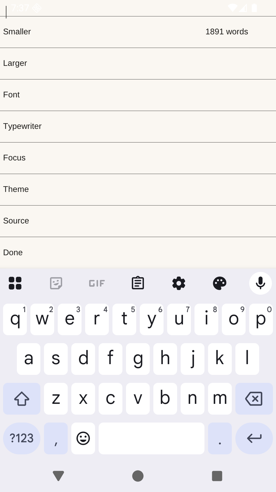

# penship

A native Android markdown editor. The name is penship for now. This is **0.1.0-alpha**.




The pictures are the app on an Android emulator, with the emulator's keyboard open. A gear at the top opens Settings. The word count is on that screen.

A push to `master` builds the app and publishes a pre-release. The attached file, `penship-android.apk`, is the Android package only: `arm64-v8a` and `x86_64` in one APK, signed with a debug keystore from that build. A tag such as `v0.2.0` publishes a release of the same Android package.

MarkText is the product to aim at: one writing surface, markdown rendered as you type, CommonMark and GitHub Flavored Markdown, source mode, typewriter mode, focus mode, themes, and a way to get the document back out. Scribe is the other reference, for a native editor that paints markdown on the text itself and stays a small program.

penship is C. The activity is `penship.Pen`, a subclass of `android.app.NativeActivity`, the same approach as [rawdrawandroid](https://github.com/cnlohr/rawdrawandroid): a manifest and a shared library. The NDK's `native_app_glue` is compiled in from the NDK. It is not vendored here. `android/Keyboard.java` asks for the soft keyboard on the main thread. `android/Pen.java` is the activity, and it also reads the file Android handed over.

The page is one UTF-8 document. `src/doc.c` is the bytes and the caret. `src/page.c` keeps a line index and paints the lines on screen with Liberation Sans, top row first, and keeps the caret on screen. The on-screen keyboard commits text into the note. A gear at the end of the page opens Settings: Smaller, Larger, Font, Typewriter, Focus, Theme, and Source. Done returns to the page. Smaller and Larger change the note between 14 and 32 sp, and Font cycles sans, serif, and mono. Ctrl+Shift+T keeps the caret line in the middle. Ctrl+Shift+F dims every other line. Ctrl+Shift+P switches the day and night palettes. The caret's line stays source, marks and all. Other lines are rendered: a heading without its hashes, a bullet instead of the list mark, a bar instead of `>`, and a fenced block on a wash without its ticks. The whole fence stays source while the caret is inside it. Shift and an arrow key selects, and typing or backspace replaces that selection. Ctrl+Z undoes, and 32 edits are kept. Both are checked on the host. On Android, key events go into the document and a tap or focus brings up the soft keyboard. The launcher opens the private note `note.md`. The Open with sheet can hand over a text file or a markdown file: `.md`, `.markdown`, `.mdown`, `.mkd`, `.mkdn`, `.mdwn`, `.mdtxt`, `.mdtext`, `.mdx`, `.qmd`, `.rmd`, `.myst`, `.txt`, `.text`, and any `text/*` type. Edits write back to that file when Android granted write access. A read-only open keeps the edits in the private file `opened.md` and leaves `note.md` alone. `samples/showcase.md` is the long note that demonstrates the marks.

## Build

The Android SDK and NDK are required. The Makefile uses `$ANDROID_HOME`, or `~/.android-sdk` when that is unset.

```sh
make
```

`make test` runs the page rasterizer on the host. `make apk` writes `build/penship.apk` for `arm64-v8a` and `x86_64`. With a device or emulator attached:

```sh
make install
```

The package is `app.penship`. The launcher label is penship. The debug APK is signed with a keystore under `build/`, which is not part of the tree.
