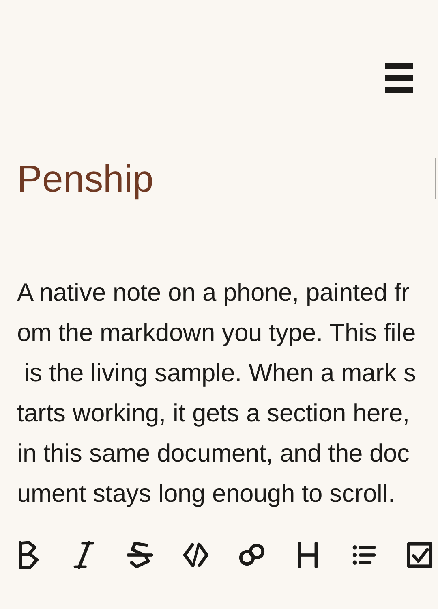
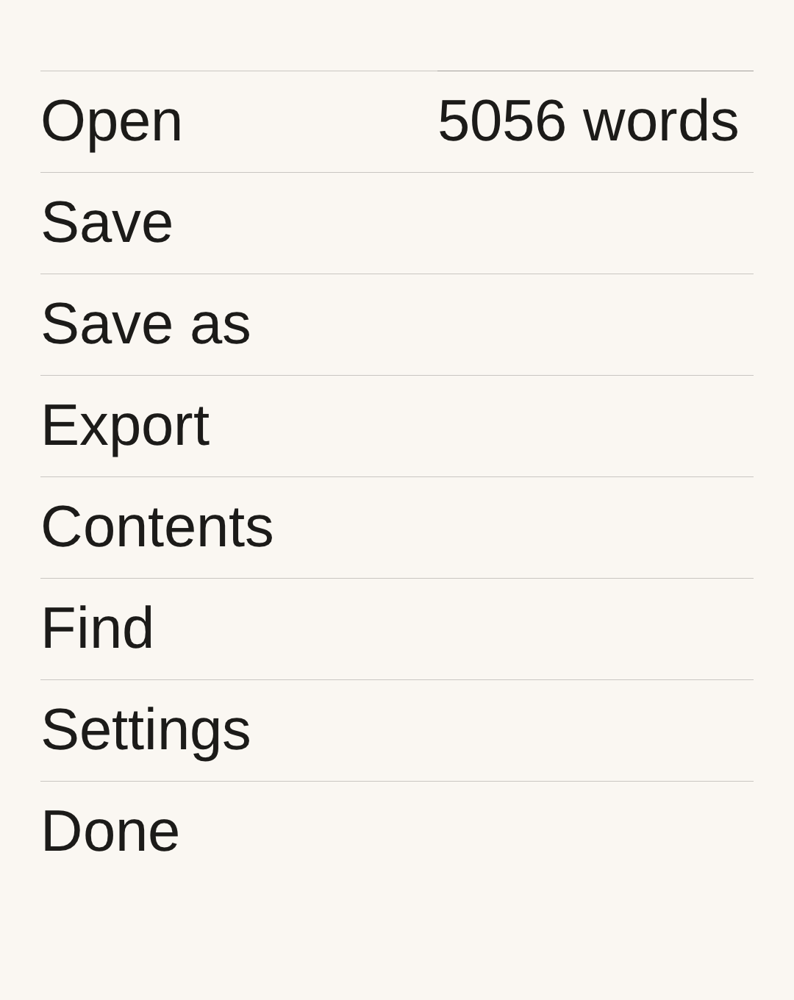

# penship

A native Android markdown editor. The name is penship for now. This is **0.1.3-alpha**.





The pictures are painted by the app at 1080 px wide, the phone's density of 460, and a font scale of 1.3. They are not a photograph of the status bar. The long sample is the note a new install starts with. The menu mark opens Open, Save, Save as, Export, Contents, Find, and Settings. The word count is on the Open row.

A push to `master` builds the app and publishes a pre-release. The attached file, `penship-android.apk`, is the Android package only: `arm64-v8a` and `x86_64` in one APK, signed with a debug keystore from that build. A tag such as `v0.2.0` publishes a release of the same Android package.

MarkText is the product to aim at: one writing surface, markdown rendered as you type, CommonMark and GitHub Flavored Markdown, source mode, typewriter mode, focus mode, themes, and a way to get the document back out. Scribe is the other reference, for a native editor that paints markdown on the text itself and stays a small program.

penship is C. The activity is `penship.Pen`, a subclass of `android.app.NativeActivity`, the same approach as [rawdrawandroid](https://github.com/cnlohr/rawdrawandroid): a manifest and a shared library. The NDK's `native_app_glue` is compiled in from the NDK. It is not vendored here. `android/Keyboard.java` asks for the soft keyboard on the main thread. `android/Pen.java` is the activity, and it also reads the file Android handed over.

The page is one UTF-8 document. `src/doc.c` keeps the bytes in a rope of chunks and the caret. `src/page.c` keeps a line index, reuses it while the note and the width stay the same, and paints the lines on screen with Liberation Sans, top row first. The line with the caret is the editor. Every other line stays rendered: a heading without its hashes, a bullet instead of the list mark, a bar instead of `>`, a link without its address, and a fenced or indented block on a wash without its ticks. A fence or a table does not open as one block. Move the caret and the source line moves with it. A double tap or a press-and-hold selects the word and offers Edit, Copy, and Cut. A single tap only moves the caret. The ends of a selection can be dragged.

A row of symbols at the bottom is bold, italic, strike, code, link, heading, list, task, quote, rule, table, and block. On a narrow window the row scrolls. Read only hides it. A flick keeps sliding the way a Chromium WebView does, then eases out. Glide, in Settings, scales that coast from off to far. A thin thumb at the right of the column shows where you are, and dragging it moves the page.

The menu mark at the end of the page opens Open, Save, Save as, Export, Contents, Find, and Settings. Contents lists the headings and a tap moves the caret there. Find takes what you type and selects the next match. Settings is its own screen: Smaller, Larger, Font, Font file, Typewriter, Focus, Line, Glide, Theme, Source, and Read only. The same menu mark closes the list and returns to the note, and so does a tap past the rows. Back closes a selection menu, then Contents, then Settings, then the file menu, then Find, then the keyboard, and it stays in the note.

Open, Save as, Export, and Font file use the system picker. Save writes the open file, and opens that same save dialog when the note is still the private scratch file or the open file cannot be written. Save as always opens the dialog and the note becomes the file you pick. Export writes an HTML page from this same buffer and leaves the note as markdown. Font file loads a TrueType file and remembers it. A file the painter cannot read leaves the current face alone. Smaller and Larger change the note between 14 and 32 sp. The first size is 24 sp. Font cycles sans, serif, and mono, and the chosen file once it has loaded. Those choices are saved and applied the next time the app opens. A new install starts from the long sample in the package. Ctrl+Shift+T keeps the caret line in the middle. Ctrl+Shift+F dims every other line. Ctrl+Shift+P switches the day and night palettes. Source shows every mark. Read only paints the whole note and ignores typing. Shift and an arrow key selects, and typing or backspace replaces that selection. Ctrl+Z undoes, and 32 edits are kept. Both are checked on the host. On Android, key events go into the document and a tap or focus brings up the soft keyboard. The launcher opens the private note `note.md`. The share sheet can hand penship a text or markdown file, or a piece of shared text, and penship opens it. The Open with sheet can hand over a text file or a markdown file: `.md`, `.markdown`, `.mdown`, `.mkd`, `.mkdn`, `.mdwn`, `.mdtxt`, `.mdtext`, `.mdx`, `.qmd`, `.rmd`, `.myst`, `.txt`, `.text`, and any `text/*` type. Edits write back to that file when Android granted write access. A read-only open keeps the edits in the private file `opened.md` and leaves `note.md` alone. `samples/showcase.md` is the long note that demonstrates the marks.

## Build

The Android SDK and NDK are required. The Makefile uses `$ANDROID_HOME`, or `~/.android-sdk` when that is unset.

```sh
make
```

`make test` runs the page rasterizer on the host. `make apk` writes `build/penship.apk` for `arm64-v8a` and `x86_64`. With a device or emulator attached:

```sh
make install
```

The package is `app.penship`. The launcher label is penship. The debug APK is signed with a keystore under `build/`, which is not part of the tree.
